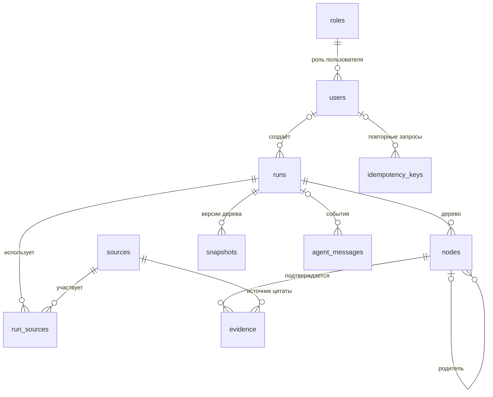

# Мультиагентная система исследования и описания прикладной деятельности

Рабочее название API-контракта: **Modeus activity-descriptor**. Прототип мультиагентной
системы для автоматизированного исследования профессиональной деятельности: система
собирает обоснования (интервью, вакансии, профстандарты, документы), строит по ним
дерево деятельности «роль -> функции -> задачи -> действия» и передаёт его методистам как
основу для актуализации образовательных программ.

## Возможности

- **Запуск исследования** - профессия или роль с подсказками и черновиками источников на старте; прогон проходит статусы «в очереди -> выполняется -> завершён / ошибка» с автообновлением страницы и уведомлением о завершении
- **Источники деятельности** - вакансии, интервью, профстандарты и документы: добавление с текстовым содержимым, список с типами и датами; удаление источника защищено, пока на него ссылаются цитаты
- **Цитаты и обоснования** - каждый узел дерева подтверждается цитатой из источника; цитаты просматриваются по источникам и по узлам, методист подтверждает обоснование одной кнопкой с откатом при ошибке сети
- **Дерево деятельности** - структура «роль -> функции -> задачи -> действия»: контракт передаёт дерево плоским списком, интерфейс восстанавливает иерархию; узлы переименовываются, меняют тип и описание, перемещаются с защитой от циклов
- **Чат-интервью с агентом** - история сообщений, отправка ответов, индикатор «агент думает»; при обрыве SSE-соединения интерфейс переподключается, синхронизирует историю и переходит на опрос как запасной канал
- **Контракт-первичность** - `openapi.yaml` единственный источник правды API; типы фронтенда генерируются из контракта, поэтому расхождения с бэкендом ловятся компилятором, а не в рантайме
- **Качество данных** - дерево не сохраняется при пустых названиях, дублях у родителя, сиротах, циклах и узлах без обоснований; эти классы ошибок отнесены к P0 и проверяются отчётом 

## Концепция системы

Три типа агентов:

| Агент | Назначение |
| --- | --- |
| Агент-интервьюер | Проводит интервью со специалистами в режиме чат-бота |
| Агент-аналитик | Автономно анализирует переданные материалы (руководства, вакансии, профстандарты), может искать их |
| Агент-синтезатор | Собирает данные, находит явные и неявные связи, формирует структурированное описание деятельности |

Результат работы системы - описание прикладной деятельности в виде дерева
«роль -> функции -> задачи -> действия», которое методисты превращают в образовательные
результаты и программы.

Стейкхолдеры:

| Роль | Интерес |
| --- | --- |
| Оператор | Запускает исследование профессии |
| Респондент | Даёт интервью о реальной деятельности |
| Методист | Использует содержание дерева в программе |
| Руководитель образовательной программы | Заказчик актуализации |

## Контракт и доменная модель

- `openapi.yaml` в корне - **единственный источник правды** для API. Типы фронтенда
  генерируются из него (`openapi-typescript`), запросы выполняются типизированным
  клиентом `openapi-fetch`. Разработка ведётся карточками: контракт расширяется карточка
  за карточкой, фронтенд и бэкенд синхронизируются через контракт, а не друг через друга.
- Префикс всех маршрутов - `/api/v1` (задан в `servers`).
- Дерево деятельности передаётся **плоским массивом узлов**, иерархия восстанавливается
  на клиенте по `parent_id`.

Ключевые сущности:

| Сущность | Назначение |
| --- | --- |
| `Run` | Исследование профессии: статус, время, корень дерева |
| `Source` | Исходный материал: вакансия, интервью, профстандарт, документ |
| `Node` | Узел дерева: роль, функция, задача или действие |
| `Evidence` | Цитата из источника, подтверждающая узел; подтверждение отмечается сервером |

Фиксированные перечисления контракта:

- Статусы прогона: `pending`, `running`, `done`, `failed`.
- Типы источников: `vacancy`, `interview`, `standard`, `document`.
- Типы узлов: `role`, `function`, `task`, `action`.

Принципы целостности данных (общие для БД и валидации):

- узел без подтверждения недействителен (`EVIDENCE_REQUIRED`);
- запрещены циклы, сироты, пустые названия и дубли узлов у одного родителя;
- источник с подтверждениями удалить нельзя;
- снимки дерева (`snapshots`) фиксируют версию результата и **не являются резервной копией**.

## Схема данных

Карта сущностей и связей Goose-миграций (`migrations/`):

### Правила удалений и защит

| Ситуация | Правило |
| --- | --- |
| Удаление пользователя-автора | `runs.created_by` обнуляется |
| Удаление узла дерева | Потомки удаляются каскадно, подтверждения узла удаляются, `runs.root_node_id` обнуляется (отложенная проверка) |
| Удаление источника с подтверждениями | Запрещено |
| Удаление источника, на который ссылаются программа или справочник | Запрещено |
| Удаление образовательной программы | Её компетенции, KSA и связи удаляются; таксономии остаются |
| Удаление элемента таксономии, используемого в связях | Запрещено |
| Повторная связь «исследование - источник» | Дубль не создаётся: пара уникальна |

### Происхождение источников и дедупликация

- `source_url` и `external_id` фиксируют происхождение материала; `raw_payload` хранит исходные структурированные данные (например, ответ API вакансий) и необязателен.
- Индекс `(type, external_id)` ускоряет поиск; уникальный индекс `(provider, type, external_id)` предотвращает дубликаты, когда поставщик и внешний ID заполнены.
- `UpsertExternalSource` обновляет такую запись вместо создания дубля; старые источники без поставщика автоматически не сопоставляются.
- `run_sources` связывает один источник с несколькими исследованиями. Legacy-поле `sources.run_id` сохранено для совместимости: триггер добавляет связь через него, но изменение или очистка поля не удаляет прежние связи.

## Безопасность и данные

- ID прогона не является проверкой доступа: перед чтением дерева, фрагментов или снимков API проверяет права пользователя.
- Персональные данные интервью (респондент, согласие, стенограмма, время) получают схему и политику хранения до работы с реальными респондентами.
- Секреты не сохраняются в Git; параметры подключения передаются через окружение.
- Факт одобрения цитаты хранится без автора: учёт одобрившего появляется вместе с моделью прав.