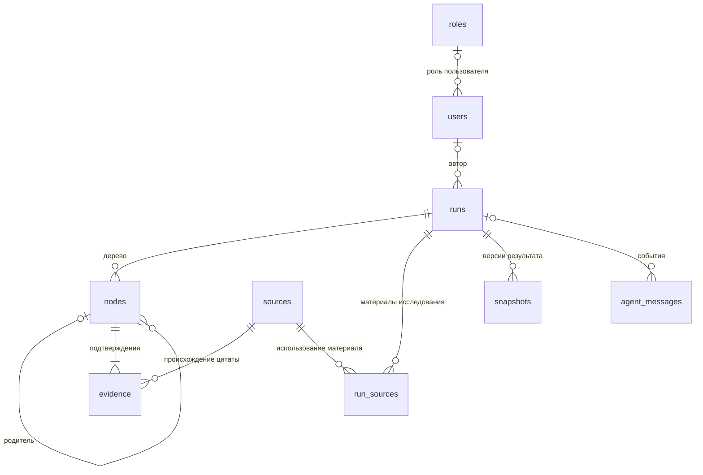

# Архитектура хранения данных

Описание схемы базы данных; обновлено 11 ноября 2026. Основная БД — PostgreSQL 16. Миграции Goose находятся в ветке feature/rustam/goose-migrations, Go-интеграция API — в ветке feature/Mikrozaym/BackEnd. Описаны реализованные механизмы и их границы.

## Основные сущности



Роль пользователя в roles отличается от профессиональной роли в nodes с type=role.

| Таблица | Назначение и важные поля |
| --- | --- |
| users, roles | Пользователь, email, отображаемое имя и необязательная роль пользователя. Эта связь пока не является механизмом выдачи JWT |
| runs | Профессия, автор, status, stage, корень дерева, время и ошибка |
| sources | Тип материала, название, содержимое, ссылка, provider, external_id, исходный JSON и состояние обработки |
| run_sources | Связь многих исследований со многими источниками; пара run_id/source_id уникальна |
| nodes | Узел, исследование, родитель, уровень, тип, название и описание |
| evidence | Узел, исследование, источник, необязательная ссылка ref_id на фрагмент, цитата и флаг approved |
| snapshots | JSON результата с подтверждениями, номер версии внутри исследования и время |
| agent_messages | JSON события, тип, состояние отправки, попытки и время следующей попытки |
| idempotency_keys | Задел хранения повторных запросов; текущий middleware бэкенда ещё использует своё хранилище в памяти |

UUID служит идентификатором записей. TIMESTAMPTZ хранит время. Поля updated_at не обновляются одним лишь DEFAULT now(): это делается предусмотренными SQL-запросами.

## Жизненный цикл исследования

status принимает pending/running/done/failed. stage хранит created/interview/analysis/synthesis/review/done/failed. Миграция 20261110000000_run_stage.sql добавляет stage; старые done/failed получают соответствующий этап, промежуточный этап старых исследований по одному status не восстанавливается. Миграция 20261112000000_run_type.sql добавляет тип исследования batch или chat; существующим исследованиям присваивается batch.

В бэкенде api.PGStore реализует сохранение состояния существующего оркестратора. Устаревший RunStatusStore записывает только status. Сервер запускает этапы оркестратора после POST создания исследования. Автоматически сформированное дерево остаётся предварительным и требует проверки человеком; полное интервью с агентом пока не реализовано.

## Дерево и целостность

Типы и уровни: role/0 → function/1 → task/2 → action/3. Родитель и потомок, а также корень и исследование должны соответствовать одному run_id. Для непустого дерева нужен один корректный корень; у каждого узла должно быть подтверждение.

ValidateTree в Go проверяет структуру до записи. Функция check_stored_tree в PostgreSQL проверяет итог после изменений: названия, дубли у родителя, циклы, родителей, типы, уровни и подтверждения. Сравнение названий учитывает удаление пробелов по краям и остаётся чувствительным к регистру. Это структурные проверки; они не доказывают истинность цитаты и вывода.

Проверки PostgreSQL отложены до фиксации транзакции. Сначала можно создать узел, затем добавить подтверждение и корень. Транзакция с незаконченным деревом не фиксируется. Изменения узлов и подтверждений одного исследования блокируют запись runs, чтобы конкурентные операции не обошли ограничения.

store.SaveTree создаёт новое дерево одной транзакцией через запросы sqlc. Готовое дерево не заменяется. В бэкенде PUT дерева использует этот метод и возвращает 422 с code/details для ошибок; SQL находится в хранилище, не в HTTP-хендлерах.

## Источники и подтверждения

Один материал можно использовать в нескольких исследованиях через run_sources. Старое sources.run_id сохранено для совместимости: запись через него добавляет связь, очистка поля не удаляет прежние связи.

Триггер link_evidence_source определяет исследование узла и автоматически связывает с ним источник. Составные внешние ключи проверяют согласованность. Источник с подтверждениями удалить нельзя. Нельзя и удалить используемую связь run_sources или последнее подтверждение существующего узла.

Уникальность внешнего материала определяется provider/type/external_id, когда provider и external_id заполнены. Provider хранится строчными буквами. Источники без этих полей автоматически не сопоставляются. API-ключи hh.ru не относятся к предметным данным и в таблицы не записываются.

approved — только флаг. Кто и когда его установил, текущая таблица не сохраняет.

## Снимки

SaveSnapshot вызывается явно. Он блокирует исследование, проверяет корень, собирает JSON одним запросом и сохраняет версию MAX(version)+1 внутри исследования. В бэкенде снимок создаётся и читается через маршруты `/api/v1/runs/{id}/snapshots`.

JSON содержит schema_version=1, корень, узлы, ID подтверждений, ref_id при наличии, цитаты, approved и ID/тип/название/ссылку источника. Полный исходный документ не копируется. Изменение исходных записей автоматически не меняет уже сохранённый снимок. Сами снимки не защищены от произвольного административного UPDATE.

При удалении исследования снимки удаляются вместе с ним. Для восстановления базы нужна отдельная резервная копия, а не снимок дерева.

## Событие завершения

Триггер enqueue_run_completed создаёт run.completed в agent_messages при переходе status в done. Уникальный индекс допускает одно такое событие для исследования. Событие и изменение статуса сохраняются в одной транзакции.

Отдельный webhook-worker читает очередь через FOR UPDATE SKIP LOCKED, отправляет JSON и отмечает результат. При ошибке повторяет попытку через минуту; ограничения числа попыток и отдельной очереди окончательно неудачных событий пока нет.

Подпись вычисляется в Go: HMAC-SHA256 точных байтов тела, строчный hex в X-Webhook-Signature. Поле agent_messages.hmac_signature сейчас не заполняется этим отправщиком. Секрет передаётся через окружение.

Доставка допускает повторы после сбоя между HTTP-ответом и фиксацией результата. Получатель должен исключать дубли по event/run_id. Реальная принимающая сторона n8n ещё требует проверки.

## Программы и справочники

taxonomies и taxonomy_items хранят справочники и элементы; education_programs и program_sources — программы и документы; program_competencies и competency_ksa — компетенции, знания/умения/навыки. Две таблицы связей сопоставляют компетенции и KSA с элементами справочников.

Отсутствие связи означает несопоставленную запись. Коды элементов уникальны внутри таксономии, коды компетенций — внутри программы, когда указаны. Код может отсутствовать в БД, но загрузчик требует стабильный код для повторного импорта.

Родитель элемента находится в том же справочнике и не равен самому элементу. Длинные циклы таксономий проверяются загрузчиком, но не запрещены полностью при прямом SQL. Источник, используемый программой или справочником, и элемент с действующими сопоставлениями защищены от удаления.

Загрузчики поддерживают JSON/CSV, текстовый PDF и типовые разделы программы; OCR сканов и универсальный смысловой разбор произвольных документов не реализованы.

## Поиск

Необязательный пакет migrations_optional/vector требует pgvector и отдельную таблицу версий Goose. source_fragments содержит цитаты-фрагменты, fragment_embeddings — векторы 768d с именем модели. HNSW ускоряет косинусный поиск; запрос ограничен источниками выбранного исследования.

find_relevant_fragments возвращает ref_id, source_id, quote, score. Ref_id — ID фрагмента. Модели при сравнении не смешиваются. Приближённый индекс с фильтрами может вернуть меньше результатов, поэтому качество на реальном корпусе проверяется отдельно.

find_fragments_bm25 выполняет лексическое ранжирование с русской конфигурацией PostgreSQL. SearchFragments использует его при сбое векторизации. SearchHybrid объединяет ранги BM25 и vector методом RRF; исходные несопоставимые оценки напрямую не складываются.

Бэкенд индексирует фрагменты до 800 символов с перекрытием 100. Неудачная векторизация не удаляет прежний индекс. Успешная переиндексация заменяет фрагменты и связанные векторы прежних моделей.

## Проверки и эксплуатация

На отдельной PostgreSQL проверены миграции, sqlc, CRUD, транзакции, ограничения, снимки, доставка события и оба поиска. Демоданные: 1 роль, 3 функции, 12 задач, 36 действий с подтверждениями; повторный seed не создаёт дубли.

Проверка качества относит пустые названия, сирот, дубли у родителя, циклы и отсутствие подтверждений к P0 и создаёт отчёт. Программа возвращает 1 при P0; GNU Make может вернуть собственный ненулевой код.

В бэкенде подготовлен воспроизводимый Compose-прогон обеих рабочих папок. Отдельно проверены настоящий hh.ru и Ollama. Описание запуска, результатов и ограничений находится в README ветки бэкенда.

База предназначена для локального компьютера команды. Резервные копии выполняются отдельно и должны проверяться восстановлением в новую тестовую БД. Автоматическое расписание и место хранения резервных копий ещё не настроены. Откаты миграций могут удалять данные; команды down применяются к рабочей базе только после оценки последствий и резервного копирования.

## Научные источники: предусмотренное расширение

Научную статью можно хранить как sources.type=document: provider обозначает каталог, external_id — DOI или ID статьи, source_url — ссылку. Её текстовые фрагменты используют тот же поиск. В ветке бэкенда добавлен явный импорт метаданных Crossref; применение весов научных источников агентами пока не реализовано.

## Научные статьи

Статьи хранятся в sources с type=document, provider=crossref и DOI в external_id. Ветка бэкенда содержит загрузку метаданных Crossref с возможностью привязать их к исследованию через run_sources. Полные тексты не загружаются. Автоматическое взвешивание источников по профессии пока не реализовано.

## Ручная резервная копия

На компьютере с PostgreSQL задайте параметры подключения `PGHOST`, `PGPORT`, `PGUSER`, `PGDATABASE`; пароль безопаснее хранить в настройке `pgpass.conf` PostgreSQL. Укажите существующую папку для копий и выполните в PowerShell:

```powershell
$backupFile = 'D:\Backups\modeus-' + (Get-Date -Format 'yyyyMMdd-HHmmss') + '.dump'
& 'D:\PostgreSQL\16\bin\pg_dump.exe' --format=custom --file=$backupFile
```

Для проверки восстановите копию только в заранее созданную отдельную пустую тестовую базу, указав её имя вместо `modeus_restore_test`:

```powershell
& 'D:\PostgreSQL\16\bin\pg_restore.exe' --exit-on-error --dbname=modeus_restore_test $backupFile
```

Пути к программам и папке копий подберите для компьютера команды. Команды не создают расписание и не удаляют старые копии. Снимок дерева не заменяет резервную копию PostgreSQL.

12 ноября 2026 создание копии и восстановление проверены на отдельном временном экземпляре PostgreSQL 16. Повторная проверка выполнена с установленным pgvector 0.8.0 и поисковыми миграциями: после восстановления расширение присутствовало в тестовой базе. Для восстановления на другом компьютере pgvector должен быть установлен и на целевом сервере.

История SSE хранится в таблице `run_sse_events` после миграции `20261112000002_sse_events.sql`. События удаляются при удалении исследования.
