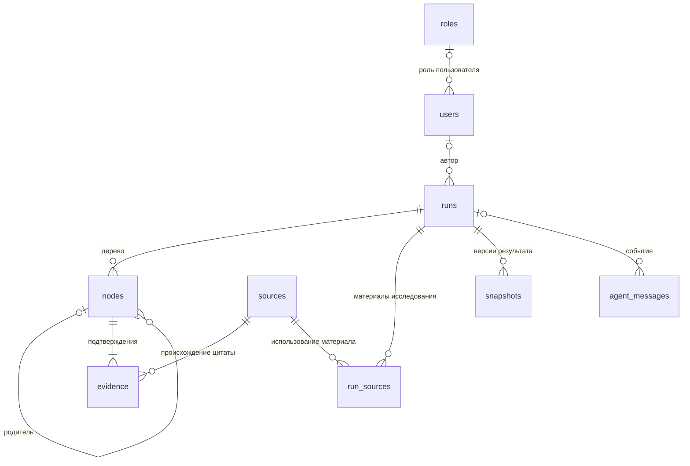

# Activity Descriptor

Прототип исследует профессиональную деятельность по интервью, вакансиям, профстандартам и документам. Мультиагентная обработка формирует дерево «роль → функции → задачи → действия» с подтверждениями из источников. Backend написан на Go и хранит данные в PostgreSQL.

## Frontend

Папка `frontend` содержит клиент на React, TypeScript и Vite: экран исследований, дерево деятельности и чат интервью с потоком событий SSE.

Для локального запуска из PowerShell:

```powershell
cd frontend
npm ci
npm run dev
```

`npm run build`, `npm run lint`, `npm run typecheck` и `npm test` выполняют соответствующие проверки frontend. `npm run mock` запускает локальный API-заглушку для интерфейса. По умолчанию клиент обращается к `http://localhost:8080/api/v1`; адрес сервера можно задать через `VITE_API_URL`.

В репозитории пока сохранена копия контракта `frontend/openapi.yaml`, отличающаяся от корневого `openapi.yaml`; синхронизацию генератора типов с общим контрактом нужно завершить отдельно. Frontend также ещё не подключён к Docker Compose: сервис `web` пока отдаёт nginx-заглушку.

## Backend
### Локальный запуск API

Нужны Go версии из go.mod и PostgreSQL. Сервер использует постоянное хранилище PGStore: исследования, дерево и подтверждения сохраняются в БД. Файл `go.mod` задаёт модуль, версию Go и зависимости, а `go.sum` хранит контрольные суммы зависимостей; оба файла нужны для сборки и должны оставаться в репозитории.

#### Подготовка

Проект использует Goose-миграции, PostgreSQL-хранилище и API. Отдельного `init.sql` нет: `20261107122603_initial_schema.sql` создаёт базовые таблицы, а полная схема получается последовательным применением всей цепочки из `migrations`. Не запускайте только первый SQL-файл. Для векторного поиска дополнительно установите pgvector и примените необязательный пакет из `migrations_optional/vector`. Подробности и откат описаны в [руководстве по миграциям](migrations/README.md).

В PowerShell задайте параметры в текущей консоли:

```powershell
$env:DATABASE_URL = 'postgres://<user>:<password>@127.0.0.1:5432/<database>?sslmode=disable'
goose -dir migrations postgres $env:DATABASE_URL up
$env:JWT_SECRET = '<секрет подписи JWT для локальной разработки>'
$env:HTTP_ADDR = '127.0.0.1:8080'
go run ./cmd/server
```

DATABASE_URL и JWT_SECRET обязательны. HTTP_ADDR по умолчанию — 127.0.0.1:8080. Старый общий API_TOKEN больше не используется: сервер проверяет JWT и роли. Секрет подписи нельзя помещать в Git.

Повторы запросов с заголовком `Idempotency-Key` разделяются по пользователю, роли, методу и адресу; повтор с другим телом возвращает 409. Сейчас ответы хранятся в памяти одного процесса и после его перезапуска не восстанавливаются.

Health доступен без токена: GET /api/v1/health. Он проверяет ответ HTTP-процесса, а не последующую доступность БД.

#### Локальный JWT и запрос

В другой консоли с тем же JWT_SECRET можно выпустить короткий JWT для локальной проверки. Это JWT нашего API, он не связан с hh.ru:

```powershell
$env:JWT_SECRET = '<тот же локальный секрет подписи>'
$access = go run ./cmd/local-token -role teacher
$headers = @{ Authorization = "Bearer $access" }
Invoke-RestMethod -Method Post -Uri http://127.0.0.1:8080/api/v1/runs -Headers $headers -ContentType 'application/json' -Body '{"profession":"Аналитик данных"}'
```

Команда local-token рассчитана на разработчика, уже имеющего секрет подписи. Для общего окружения нужен согласованный механизм аутентификации пользователей; HTTP-маршрут свободной выдачи JWT здесь не добавлен.

#### Демонстрационные пользователи admin и guest

Для показа frontend можно выпустить два готовых JWT на 24 часа: `demo-admin` с ролью admin и `demo-guest` с ролью guest. Команда использует тот же `JWT_SECRET`, что и сервер, и не требует PostgreSQL:

```powershell
$env:JWT_SECRET = '<тот же локальный секрет подписи>'
go run ./cmd/test-users          # строки VITE_API_TOKEN для PowerShell и bash/zsh
go run ./cmd/test-users -json    # те же данные в JSON для автоматизации
```

В PowerShell готовые строки для нужной роли печатает helper:

```powershell
.\scripts\Test-Users.ps1 -Role guest
.\scripts\Test-Users.ps1 -Role admin
```

Токены не записываются в репозиторий: они живут только в выводе команды, а `JWT_SECRET` и `.env*` исключены из Git.

Frontend читает токен из `VITE_API_TOKEN` при запуске dev-сервера. Задайте её в текущей консоли или в `frontend/.env.local` (файл исключён из Git):

```powershell
cd frontend
$env:VITE_API_TOKEN = '<токен из вывода test-users>'
npm run dev
```

Роль guest только для чтения: ей доступен просмотр исследований, дерева, сообщений, снимков, источников, подтверждений, поиска и экспорта. Создание исследований, отправка сообщений, запись и правка дерева, утверждение подтверждений, создание, индексация и удаление источников для guest запрещены. Существующие ограничения не ослаблены: удаление источников остаётся доступно только admin, а роли admin, teacher, rop и student сохраняют прежние права. Интерфейс не определяет роль по токену, поэтому изменяющие действия с guest-токеном вернут 403.

#### Компоненты

- PUT /api/v1/runs/{id}/tree сохраняет новое дерево одной транзакцией; ошибки возвращаются как 422 с code/details.
- POST /api/v1/sources/{id}/index создаёт фрагменты и векторы; GET /api/v1/runs/{id}/search выполняет поиск. strategy=hybrid объединяет ранги BM25 и vector.
- go run ./cmd/webhook-worker отдельно читает очередь run.completed. Нужны DATABASE_URL, WEBHOOK_URL, WEBHOOK_SECRET. Реальный n8n требует настройки принимающей стороны.
- scripts/Configure-Hh.ps1 сохраняет уже действующий токен hh.ru в Windows DPAPI вне проекта. scripts/Import-HhVacancies.ps1 использует его без перевыпуска.
- GET /api/v1/runs, POST /api/v1/sources, PATCH /api/v1/nodes/{id}, POST /api/v1/evidences/bulk-approve и DELETE /api/v1/sources/{id} работают через PostgreSQL. Источник, на который ссылаются подтверждения или другие защищённые записи, удалить нельзя: возвращается 409.
- GET /api/v1/sources и GET /api/v1/sources/{id} читают источники; GET /api/v1/evidences позволяет отфильтровать подтверждения по `node_id` или `source_id`. GET /api/v1/evidences/{id} возвращает отдельное подтверждение и статус его одобрения `approved`. POST /api/v1/evidences добавляет подтверждение к существующему узлу и требует `node_id`, `source_id` и цитату. При чтении списка за один запрос возвращается не больше 1000 записей.
- POST /api/v1/runs/{id}/snapshots явно создаёт новую версию снимка; GET по этому адресу возвращает версии, а GET /api/v1/runs/{id}/snapshots/{snapshot_id} — выбранный снимок. В каждом снимке сохранены дерево, цитаты и сведения об источниках на момент создания. Снимок пустого дерева создать нельзя.
- Подтверждение может содержать `ref_id` — идентификатор фрагмента или сообщения в исходном материале. Он сохраняется вместе с цитатой и попадает в новые снимки; старые подтверждения без `ref_id` продолжают работать.

Запись дерева доступна ролям admin, teacher и rop. Проверяются корень, уровни, циклы, дубли и наличие подтверждений; готовое дерево повторно не создаётся (HTTP 409). Ошибка ссылки на источник откатывает всю транзакцию. Поиск и индексация требуют отдельного пакета миграций pgvector. При недоступности модели поиск переключается на BM25 по уже индексированным фрагментам. Если индексирование нового текста завершилось ошибкой, прежний индекс сохраняется.

Автоматическая доставка события выполняется отдельным процессом `go run ./cmd/webhook-worker`. Подпись — HMAC-SHA256 точных байтов тела запроса, шестнадцатеричное значение передаётся в заголовке `X-Webhook-Signature`. Доставка допускает повтор: получателю необходимо распознавать повторное событие по `run_id` и типу. Проверка с настоящим n8n ещё нужна.

Контракт маршрутов описан в openapi.yaml. Описание загрузки и проверенного профиля поиска приведено ниже.
Статические файлы Swagger сохранены в `api-docs/` и доступны по публичному `/swagger/` (маршрут добавлен в auth-whitelist); спецификацию необходимо обновлять вместе с маршрутами.

#### Проверки

Юнит-тесты: `go test ./...` или из PowerShell `.\tests\unit\run.ps1`. Полный локальный запуск с `go vet` и офлайн e2e: `.\tests\run.ps1`.

Для интеграционных тестов задайте INGEST_TEST_DATABASE_URL отдельной тестовой PostgreSQL. Не используйте рабочую базу.

Воспроизводимый запуск на новом проекте Docker Compose:

```powershell
./scripts/Test-Acceptance.ps1 -DatabaseRepository 'D:\modeus_project\Modeus_hakaton'
```

Скрипт применяет миграции через установленный Goose, проверяет обе рабочие папки в Linux-контейнере и сохраняет логи в data/acceptance/. После проверки удаляется только созданный тестовый проект Compose. Скрипт использует текущие файлы папок, поэтому перед запуском проверьте обе ветки.

Общий сценарий использует настоящие API, PostgreSQL, оркестратор и HTTP-отправщик; шаги агентов и получатель webhook тестовые. Реальные hh.ru и Ollama проверяются отдельно. Завершить сервер можно Ctrl+C.


#### Автоматическое исследование

В запущенном сервере POST /api/v1/runs создаёт исследование в режиме интервью. Если LLM не настроена, интервьюер задаёт резервные вопросы. После интервью аналитик извлекает узлы с цитатами, а синтезатор собирает дерево; для этого нужен настроенный клиент аналитика. Чат и его сообщения пока хранятся в памяти процесса, поэтому после перезапуска незавершённый диалог не восстанавливается. Отдельный пакетный оркестратор вакансий сохранён, но текущий сервер запускает новые исследования в режиме интервью.

Этапы передаются через SSE. История событий хранится в PostgreSQL и доступна после перезапуска; при повторном подключении заголовок `Last-Event-ID` позволяет продолжить чтение. История удаляется вместе с исследованием. Сохранение этапа и события пока выполняется отдельными операциями, поэтому при сбое между ними событие может отсутствовать. Доставку при реальной нагрузке нужно дополнительно проверить.

#### Научные статьи

`go run ./cmd/ingest articles -query "data science" -limit 10 -run UUID_ИССЛЕДОВАНИЯ` получает названия, DOI и доступные аннотации из Crossref. Параметр -run необязателен; без него статьи будут загружены в общий список источников. Повторный импорт не создаёт дубли. Источники учитываются в исследовании явно, автоматического выбора важности статей по профессии пока нет. Полные тексты не скачиваются. Перед использованием аннотации необходимо учитывать права её владельца.

#### Нагрузочная проверка

`go run ./cmd/loadcheck -url http://127.0.0.1:8080/api/v1/health -requests 100 -concurrency 5` выводит JSON с количеством ответов и ошибок, пропускной способностью и задержками p50/p95/p99 в миллисекундах. Для защищённого GET-маршрута передайте JWT в переменной MODEUS_LOAD_TOKEN. При ошибках ответов команда вернёт ненулевой код. Проверка health не проверяет PostgreSQL: для оценки нагрузки базы выберите защищённый маршрут чтения дерева существующего тестового исследования. Порогов приёмки для карточки пока не задано; результат зависит от оборудования и набора данных.

#### Результаты операций и ошибки

В `internal/domain` добавлены `Result[T]`, `Success`, `Failure` и `Unwrap`: результат может хранить либо значение, либо ошибку. `domain.Error` содержит стабильный код, понятное сообщение и причину; `errors.Is` и `errors.As` работают с вложенной ошибкой. Существующие интерфейсы используют привычную форму Go `(значение, error)` и массово не переписывались. Сейчас доменная ошибка используется для проверки параметров поиска статей; общий перевод всех ошибок API на эту модель ещё не выполнен.

#### История приёмки

10 ноября на отдельной PostgreSQL были проверены миграции, sqlc, хранилище, повторный импорт и синтетический сквозной сценарий. Также отдельно проверены hh.ru и Ollama. Этот исторический результат не подтверждает текущую сборку после обновления кода. Чистый Compose и настоящий n8n необходимо перепроверить с актуальными версиями. Токены не помещаются в репозиторий.
### Загрузка источников и учебных программ

Команда `go run ./cmd/ingest` использует `DATABASE_URL`. Перед запуском к базе должны быть применены обязательные миграции из `migrations`; для операций векторного поиска дополнительно нужны расширение pgvector и необязательные миграции из `migrations_optional/vector`.

#### Вакансии

`go run ./cmd/ingest vacancies -file vacancies.json -format json`

`go run ./cmd/ingest vacancies -file vacancies.csv -format csv`

`go run ./cmd/ingest vacancies -query "аналитик" -pages 2`

JSON — массив объектов или ответ hh.ru с массивом `items`. У каждой вакансии обязательны строки `id` и `name`; дополнительно принимаются `description`, `alternate_url` и `snippet`. CSV должен иметь заголовки `id,name`; необязательные поля — `description,alternate_url`. Идентификаторы файлов должны быть идентификаторами hh.ru.

Для API надо задать `HH_USER_AGENT` с названием приложения и реальным контактом разработчика. При необходимости авторизованного доступа можно дополнительно передать `HH_ACCESS_TOKEN` через окружение. ID и секрет приложения не являются токеном; команда не выпускает токен автоматически. Ключи не добавляются в базу и исходный код.

Результат — JSON со счётчиками `inserted`, `updated`, `skipped`. Повтор одинаковой записи пропускается; импорт одной партии выполняется в транзакции. Поиск hh.ru возвращает краткие сведения; текст формируется из `description` или `snippet`, полная карточка вакансии отдельно не запрашивается.

#### Профстандарты

`go run ./cmd/ingest standard -file standard.json -format json -key standard-01`

`go run ./cmd/ingest standard -file standard.pdf -format pdf -title "Название" -key standard-01`

JSON содержит `title`, `content` и необязательный `url`. Ключ задаётся один раз и используется повторно для обновления. Из PDF извлекается текстовый слой; изображения и сканы без OCR не поддерживаются. Распознавание сложной вёрстки и кириллицы конкретных PDF необходимо отдельно проверять на реальных документах.

#### Таксономии

`go run ./cmd/ingest taxonomy -file taxonomy.json -format json -key taxonomy-01`

`go run ./cmd/ingest taxonomy -file taxonomy.csv -format csv -name "Справочник" -key taxonomy-01`

JSON: `{"name":"Справочник","version":"1","items":[{"code":"A","title":"Анализ"},{"code":"B","title":"Проверка","parent_code":"A"}]}`. CSV содержит `code,title,parent_code`; `parent_code` может быть пустым. У каждого элемента обязателен стабильный код. Проверяются пустые поля, повторные коды, отсутствующие родители и циклы. Уже существующие элементы отсутствующие во входном файле автоматически не удаляются.

#### Образовательные программы

`go run ./cmd/ingest education -file program.json -key program-01 -taxonomy UUID_ТАКСОНОМИИ`

JSON: `{"title":"Программа","competencies":[{"code":"К1","title":"Анализ","taxonomy_codes":["A"],"ksa":[{"kind":"knowledge","title":"Модели","taxonomy_codes":["A"]}]}]}`.

Допустимые значения `kind`: `knowledge`, `skill`, `ability`. Если параметр `-taxonomy` не задан, коды не сопоставляются; в ответе возвращаются число несопоставленных компетенций и KSA, а также неизвестные коды. Повторный импорт не удаляет прежние записи и сопоставления.

Также можно загружать явно размеченный `-format text` или текстовый PDF `-format pdf` с параметром `-title`. Строки имеют вид `Компетенция: К1 | Название`, затем `Знание: ...`, `Умение: ...`, `Навык: ...`. Также поддерживается типовая текстовая структура: код УК/ОПК/ПК/ОК, название компетенции и блоки Знать/Уметь/Владеть. Извлечённые данные проверяются, неполные записи отклоняются. Произвольная вёрстка и сканы требуют отдельной обработки; OCR и извлечение смысла моделью не подключены.

#### Проверка

Юнит-тесты и интеграционные тесты загрузчиков: `go test ./internal/ingestion/...`. Для проверок PostgreSQL задайте `INGEST_TEST_DATABASE_URL` как адрес отдельной тестовой базы с применёнными миграциями. Без него тесты базы пропускаются. При ошибке команда пишет сообщение в stderr и завершает работу с ненулевым кодом.

#### Настройка hh.ru на Windows

Используется уже действующий токен приложения. Скрипты не запрашивают новый токен и не отзывают старый.

scripts/Configure-Hh.ps1 принимает существующий HH_ACCESS_TOKEN из окружения. Вместо окружения можно указать -TokenFile с путём к локальному текстовому файлу, содержащему только действующий токен. Реквизиты client_id/client_secret здесь не нужны. Токен сохраняется зашифрованным Windows DPAPI в %LOCALAPPDATA%/ModeusProject/hh-auth.xml, вне репозитория, и не выводится.

scripts/Import-HhVacancies.ps1 -Query 'аналитик' -Pages 1 передаёт сохранённый токен дочернему Go-процессу через окружение. Токен не передаётся аргументами командной строки. Нужны DATABASE_URL и при необходимости HH_USER_AGENT с контактами разработчика. Скрипты предназначены для Windows. Сам токен нельзя помещать в Git или присылать в чат.

### Проверенный локальный профиль векторного поиска

Дата: 10 ноября 2026. Ollama 0.40.16, CPU-профиль.

- Модель: nomic-ai/nomic-embed-text-v1.5-GGUF, вариант Q4_K_M, размерность 768.
- Локальное имя в Ollama: nomic-embed-text:v1.5-q4km.
- Репозиторий автора: https://huggingface.co/nomic-ai/nomic-embed-text-v1.5-GGUF
- Ревизия: 0188c9bf409793f810680a5a431e7b899c46104c.
- Файл: nomic-embed-text-v1.5.Q4_K_M.gguf, 84 106 624 байта.
- Проверенная SHA256: d4e388894e09cf3816e8b0896d81d265b55e7a9fff9ab03fe8bf4ef5e11295ac.
- Образ Ollama: ollama/ollama@sha256:910d0d8107b538fb0894e63163eb195de0cc7aefcbc666dc62d3b18f71124592.

Файл получен из репозитория автора по HTTPS и импортирован штатным механизмом GGUF. Защита Ollama и проверка сертификатов не отключались. Modelfile:

```text
FROM /path/to/nomic-embed-text-v1.5.Q4_K_M.gguf
PARAMETER num_ctx 2048
PARAMETER num_thread 4
```

После ollama create nomic-embed-text:v1.5-q4km -f Modelfile задайте OLLAMA_EMBED_MODEL=nomic-embed-text:v1.5-q4km в окружении бэкенда. Адрес задаётся OLLAMA_URL, по умолчанию http://127.0.0.1:11434. Векторы запроса и фрагментов должны строиться одной моделью; в базе имя модели хранится вместе с вектором.

#### Измерение

Тест TestНастоящаяOllamaДесятьЗапросов построил 100 фрагментов с настоящими векторами и выполнил десять разных поисковых запросов через Ollama и PostgreSQL. Максимальная задержка запроса: 47,3784 мс, все запросы менее 2 секунд. Время теста вместе с индексацией: около 70 секунд. Измеряется тёплая модель; холодная загрузка в лимит запросов не входит.

Корпус синтетический и небольшой. Это подтверждает работоспособность и задержку в указанном окружении, но не качество ранжирования реальных русскоязычных документов и не производительность под параллельной нагрузкой. На другом оборудовании измерение нужно повторить.

Для сравнения, первый прогон полной f16-модели со стандартными настройками превысил 2 секунды на одном запросе; этот результат не засчитывался как успешный.

Для повторения задайте INGEST_TEST_DATABASE_URL отдельной тестовой БД, OLLAMA_TEST_URL и OLLAMA_EMBED_MODEL, затем выполните:

```powershell
go test -v -count=1 ./internal/search -run TestНастоящаяOllamaДесятьЗапросов
```

Локальный лог: data/acceptance/real-model/search.log. Большие файлы модели и тестовые логи в Git не включены.

## База данных
### Архитектура хранения данных

Описание схемы базы данных; обновлено 11 ноября 2026. Основная БД — PostgreSQL 16. В интеграционной ветке `dev` объединены Goose-миграции, Go-хранилище и API.

#### Основные сущности



Роль пользователя в roles отличается от профессиональной роли в nodes с type=role.

| Таблица | Назначение и важные поля |
| --- | --- |
| users, roles | Пользователь, email, отображаемое имя и необязательная роль пользователя. Эта связь пока не является механизмом выдачи JWT |
| runs | Профессия, автор, status, stage, корень дерева, время и ошибка |
| sources | Тип материала, название, содержимое, ссылка, provider, external_id, исходный JSON и состояние обработки |
| run_sources | Связь многих исследований со многими источниками; пара run_id/source_id уникальна |
| nodes | Узел, исследование, родитель, уровень, тип, название и описание |
| evidence | Узел, исследование, источник, необязательная ссылка ref_id на фрагмент, цитата и флаг approved |
| snapshots | JSON результата с подтверждениями, номер версии внутри исследования и время |
| agent_messages | JSON события, тип, состояние отправки, попытки и время следующей попытки |
| idempotency_keys | Задел хранения повторных запросов; текущий middleware бэкенда ещё использует своё хранилище в памяти |

UUID служит идентификатором записей. TIMESTAMPTZ хранит время. Поля updated_at не обновляются одним лишь DEFAULT now(): это делается предусмотренными SQL-запросами.

#### Жизненный цикл исследования

status принимает pending/running/done/failed/degraded. stage хранит created/interview/analysis/synthesis/review/done/failed. Миграция 20261110000000_run_stage.sql добавляет stage; старые done/failed получают соответствующий этап, промежуточный этап старых исследований по одному status не восстанавливается. Миграция 20261112000000_run_type.sql добавляет тип исследования batch или chat; существующим исследованиям присваивается batch.

В бэкенде api.PGStore сохраняет состояние исследования. RunStatusStore записывает только status. Сервер создаёт исследование с интервью; сообщения чата пока хранятся в памяти и теряются при перезапуске. Автоматически сформированное дерево требует проверки человеком.

#### Дерево и целостность

Типы и уровни: role/0 → function/1 → task/2 → action/3. Родитель и потомок, а также корень и исследование должны соответствовать одному run_id. Для непустого дерева нужен один корректный корень; у каждого узла должно быть подтверждение.

ValidateTree в Go проверяет структуру до записи. Функция check_stored_tree в PostgreSQL проверяет итог после изменений: названия, дубли у родителя, циклы, родителей, типы, уровни и подтверждения. Сравнение названий учитывает удаление пробелов по краям и остаётся чувствительным к регистру. Это структурные проверки; они не доказывают истинность цитаты и вывода.

Проверки PostgreSQL отложены до фиксации транзакции. Сначала можно создать узел, затем добавить подтверждение и корень. Транзакция с незаконченным деревом не фиксируется. Изменения узлов и подтверждений одного исследования блокируют запись runs, чтобы конкурентные операции не обошли ограничения.

store.SaveTree создаёт новое дерево одной транзакцией через запросы sqlc. Готовое дерево не заменяется. В бэкенде PUT дерева использует этот метод и возвращает 422 с code/details для ошибок; SQL находится в хранилище, не в HTTP-хендлерах. После изменения запросов в `db/queries` выполните `sqlc generate` из корня проекта (используется sqlc v1.30.0).

#### Источники и подтверждения

Один материал можно использовать в нескольких исследованиях через run_sources. Старое sources.run_id сохранено для совместимости: запись через него добавляет связь, очистка поля не удаляет прежние связи.

Триггер link_evidence_source определяет исследование узла и автоматически связывает с ним источник. Составные внешние ключи проверяют согласованность. Источник с подтверждениями удалить нельзя. Нельзя и удалить используемую связь run_sources или последнее подтверждение существующего узла.

Уникальность внешнего материала определяется provider/type/external_id, когда provider и external_id заполнены. Provider хранится строчными буквами. Источники без этих полей автоматически не сопоставляются. API-ключи hh.ru не относятся к предметным данным и в таблицы не записываются.

approved — только флаг. Кто и когда его установил, текущая таблица не сохраняет.

#### Снимки

SaveSnapshot вызывается явно. Он блокирует исследование, проверяет корень, собирает JSON одним запросом и сохраняет версию MAX(version)+1 внутри исследования. В бэкенде снимок создаётся и читается через маршруты `/api/v1/runs/{id}/snapshots`.

JSON содержит schema_version=1, корень, узлы, ID подтверждений, ref_id при наличии, цитаты, approved и ID/тип/название/ссылку источника. Полный исходный документ не копируется. Изменение исходных записей автоматически не меняет уже сохранённый снимок. Сами снимки не защищены от произвольного административного UPDATE.

При удалении исследования снимки удаляются вместе с ним. Для восстановления базы нужна отдельная резервная копия, а не снимок дерева.

#### Событие завершения

Триггер enqueue_run_completed создаёт run.completed в agent_messages при переходе status в done. Уникальный индекс допускает одно такое событие для исследования. Событие и изменение статуса сохраняются в одной транзакции.

Отдельный webhook-worker читает очередь через FOR UPDATE SKIP LOCKED, отправляет JSON и отмечает результат. При ошибке повторяет попытку через минуту; ограничения числа попыток и отдельной очереди окончательно неудачных событий пока нет.

Подпись вычисляется в Go: HMAC-SHA256 точных байтов тела, строчный hex в X-Webhook-Signature. Поле agent_messages.hmac_signature сейчас не заполняется этим отправщиком. Секрет передаётся через окружение.

Доставка допускает повторы после сбоя между HTTP-ответом и фиксацией результата. Получатель должен исключать дубли по event/run_id. Реальная принимающая сторона n8n ещё требует проверки.

#### Программы и справочники

taxonomies и taxonomy_items хранят справочники и элементы; education_programs и program_sources — программы и документы; program_competencies и competency_ksa — компетенции, знания/умения/навыки. Две таблицы связей сопоставляют компетенции и KSA с элементами справочников.

Отсутствие связи означает несопоставленную запись. Коды элементов уникальны внутри таксономии, коды компетенций — внутри программы, когда указаны. Код может отсутствовать в БД, но загрузчик требует стабильный код для повторного импорта.

Родитель элемента находится в том же справочнике и не равен самому элементу. Длинные циклы таксономий проверяются загрузчиком, но не запрещены полностью при прямом SQL. Источник, используемый программой или справочником, и элемент с действующими сопоставлениями защищены от удаления.

Загрузчики поддерживают JSON/CSV, текстовый PDF и типовые разделы программы; OCR сканов и универсальный смысловой разбор произвольных документов не реализованы.

#### Поиск

Необязательный пакет migrations_optional/vector требует pgvector и отдельную таблицу версий Goose. source_fragments содержит цитаты-фрагменты, fragment_embeddings — векторы 768d с именем модели. HNSW ускоряет косинусный поиск; запрос ограничен источниками выбранного исследования.

find_relevant_fragments возвращает ref_id, source_id, quote, score. Ref_id — ID фрагмента. Модели при сравнении не смешиваются. Приближённый индекс с фильтрами может вернуть меньше результатов, поэтому качество на реальном корпусе проверяется отдельно.

find_fragments_bm25 выполняет лексическое ранжирование с русской конфигурацией PostgreSQL. SearchFragments использует его при сбое векторизации. SearchHybrid объединяет ранги BM25 и vector методом RRF; исходные несопоставимые оценки напрямую не складываются.

Бэкенд индексирует фрагменты до 800 символов с перекрытием 100. Неудачная векторизация не удаляет прежний индекс. Успешная переиндексация заменяет фрагменты и связанные векторы прежних моделей.

#### Проверки и эксплуатация

На отдельной PostgreSQL проверены миграции, sqlc, CRUD, транзакции, ограничения, снимки, доставка события и оба поиска. Демоданные: 1 роль, 3 функции, 12 задач, 36 действий с подтверждениями; повторный seed не создаёт дубли.

Проверка качества относит пустые названия, сирот, дубли у родителя, циклы и отсутствие подтверждений к P0 и создаёт отчёт. Программа возвращает 1 при P0; GNU Make может вернуть собственный ненулевой код.

Покрытие базы проверяется отдельно для двух видов тестов. Unit-тесты запросов хранения находятся в корневой `tests/unit/store/`; тесты приватных правил дерева и форматирования вектора остаются рядом с кодом. Запусти `.\scripts\Test-DatabaseUnitCoverage.ps1` в PowerShell: проверки используют замоканное подключение, не требуют PostgreSQL и должны покрывать не менее 80% написанной вручную логики хранения. Сгенерированный sqlc-код в этот процент не входит.

Интеграционные проверки PostgreSQL находятся в корневой `tests/database/`. Для них нужна отдельная тестовая БД с основными миграциями; для поисковых проверок также применяются `migrations_optional/vector`. Задай `STORE_TEST_DATABASE_URL`, `OUTBOX_TEST_DATABASE_URL` и `VECTOR_TEST_DATABASE_URL`, затем выполни `.\scripts\Test-DatabaseCoverage.ps1` в PowerShell или `make db-coverage` в GNU Make. Отчёт покрытия создаётся в `coverage-db.out`, а скрипт требует не менее 70%; цель охватывает бизнес-пакеты хранения, доменные правила, демоданные и очередь событий, исключая сгенерированный sqlc-код и точки входа команд.

В бэкенде подготовлен воспроизводимый Compose-прогон обеих рабочих папок. Отдельно проверены настоящий hh.ru и Ollama. Описание запуска, результатов и ограничений находится в README ветки бэкенда.

База предназначена для локального компьютера команды. Резервные копии выполняются отдельно и должны проверяться восстановлением в новую тестовую БД. Автоматическое расписание и место хранения резервных копий ещё не настроены. Откаты миграций могут удалять данные; команды down применяются к рабочей базе только после оценки последствий и резервного копирования.

#### Научные источники: предусмотренное расширение

Научную статью можно хранить как sources.type=document: provider обозначает каталог, external_id — DOI или ID статьи, source_url — ссылку. Её текстовые фрагменты используют тот же поиск. В ветке бэкенда добавлен явный импорт метаданных Crossref; применение весов научных источников агентами пока не реализовано.

#### Научные статьи

Статьи хранятся в sources с type=document, provider=crossref и DOI в external_id. Ветка бэкенда содержит загрузку метаданных Crossref с возможностью привязать их к исследованию через run_sources. Полные тексты не загружаются. Автоматическое взвешивание источников по профессии пока не реализовано.

#### Ручная резервная копия

На компьютере с PostgreSQL задайте параметры подключения `PGHOST`, `PGPORT`, `PGUSER`, `PGDATABASE`; пароль безопаснее хранить в настройке `pgpass.conf` PostgreSQL. Укажите существующую папку для копий и выполните в PowerShell:

```powershell
$backupFile = 'D:\Backups\modeus-' + (Get-Date -Format 'yyyyMMdd-HHmmss') + '.dump'
& 'D:\PostgreSQL\16\bin\pg_dump.exe' --format=custom --file=$backupFile
```

Для проверки восстановите копию только в заранее созданную отдельную пустую тестовую базу, указав её имя вместо `modeus_restore_test`:

```powershell
& 'D:\PostgreSQL\16\bin\pg_restore.exe' --exit-on-error --dbname=modeus_restore_test $backupFile
```

Пути к программам и папке копий подберите для компьютера команды. Команды не создают расписание и не удаляют старые копии. Снимок дерева не заменяет резервную копию PostgreSQL.

12 ноября 2026 создание копии и восстановление проверены на отдельном временном экземпляре PostgreSQL 16. Повторная проверка выполнена с установленным pgvector 0.8.0 и поисковыми миграциями: после восстановления расширение присутствовало в тестовой базе. Для восстановления на другом компьютере pgvector должен быть установлен и на целевом сервере.

История SSE хранится в таблице `run_sse_events` после миграции `20261112000002_sse_events.sql`. События удаляются при удалении исследования.

### Наблюдаемость LLM

Миграции `20261115000000_llm_observability.sql` и `20261115000001_agent_runtime.sql` добавляют реестр версий промптов, журнал запросов и ответов моделей, учёт токенов и оценок, безопасные PII-находки и поля повторных попыток агентов. Подробное описание таблиц и ограничений хранения данных находится в [документе о LLM-схеме](migrations/LLM_OBSERVABILITY.md).


## Интервью и AI-обработка

Сервер подключает интервьюера к API и после завершения интервью может передать
расшифровку аналитику и синтезатору. Аналитик извлекает функции, задачи и действия
с цитатами; синтезатор объединяет результаты и разрешает расхождения по приоритету
источников. Результат сохраняется в PostgreSQL как источник интервью, дерево и
подтверждения.

- `POST /api/v1/runs` создаёт интервью; `GET/POST /api/v1/runs/{id}/messages`
  читает и добавляет сообщения.
- `GET /api/v1/runs/{id}/events` передаёт этапы и события чата через SSE.
- Поддерживаются клиенты Ollama и OpenRouter/Nemotron, ограничение повторных
  запросов к модели, защита от prompt injection и выявление персональных данных.
- Диалог пока хранится в памяти сервера. Для восстановления интервью после
  перезапуска нужна отдельная постоянная модель хранения сообщений и сессий.
- Если клиент аналитика не настроен, резервное интервью доступно, но итоговое
  дерево автоматически не формируется.

Структура входов и выходов агентов описана в `docs/agents/AGENT_IO.md`, а
локальный сквозной пример — в `docs/E2E.md`. Сравнение температур интервьюера
15 ноября не дало результатов: все запросы завершились ошибкой провайдера.

## DevOps: локальный запуск и наблюдаемость

Для локального запуска контейнерного стека скопируйте шаблон переменных окружения и запустите Compose:

```powershell
Copy-Item .env.example .env
docker compose up -d --build
```

В этом наборе `api` — демонстрационный API с хранением в памяти, а `web` — nginx-заглушка. Они нужны для проверки упаковки и сценария без подключения production-хранилища. Рабочий сервер с PostgreSQL запускается отдельно через `cmd/server`. Сервисы Prometheus/Grafana и n8n подключаются профилями `monitoring` и `automation` соответственно. Локальные значения в `.env` нужно заменить перед любым общим или публичным запуском.

Полезные цели Make: `make docker-build`, `make docker-size`, `make up`, `make down`, `make check-deploy`. Документация по запуску, метрикам, Grafana, n8n и CI находится в `docs/DOCKER.md`, `docs/METRICS.md`, `docs/GRAFANA.md`, `docs/N8N.md` и `docs/CI.md`.
