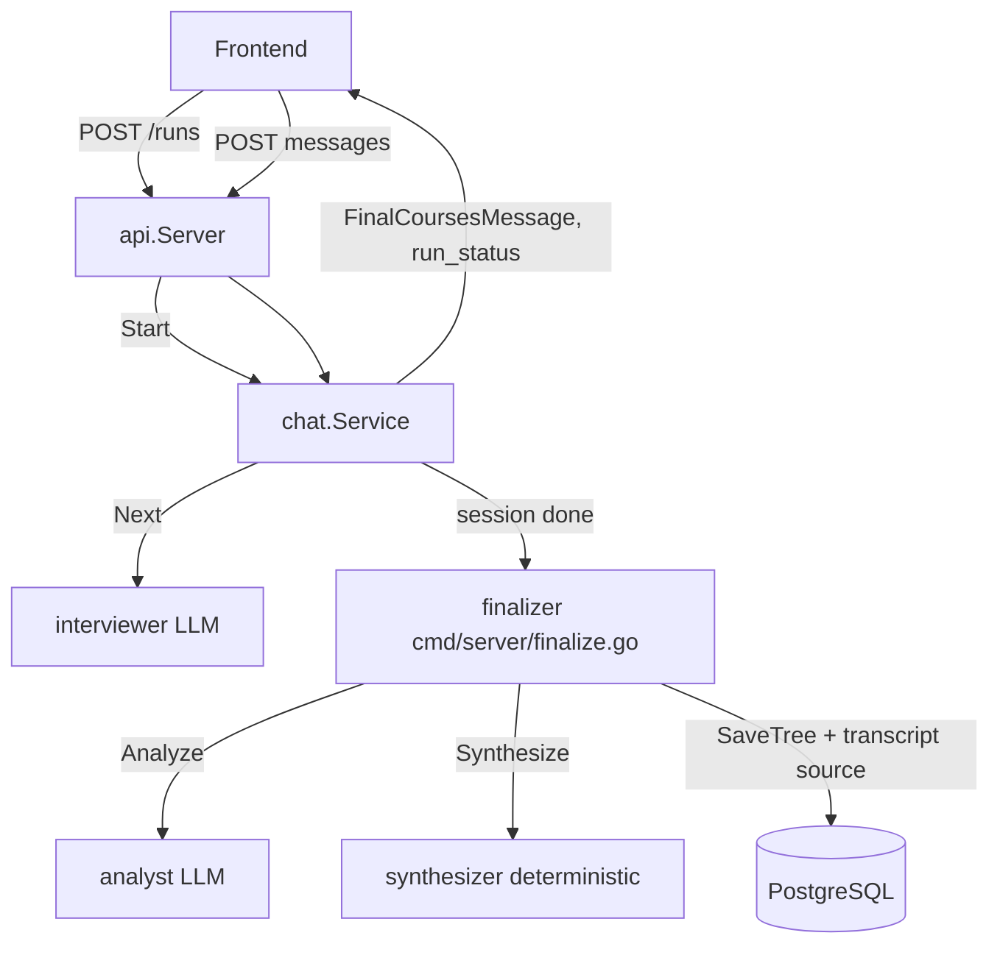
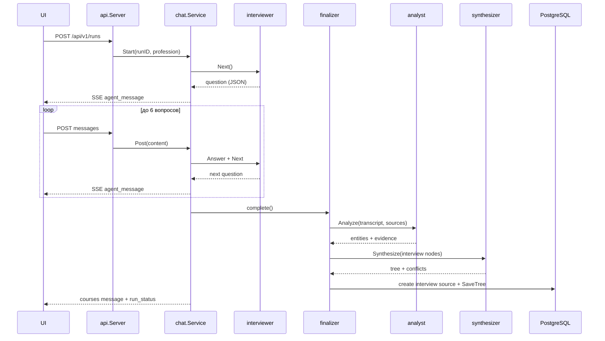

# Архитектура пайплайна агентов

Текущий контур: **interviewer → analyst → synthesizer → дерево → завершение
чата**. Контракт обмена — `agent.io/v1` ([AGENT_IO.md](AGENT_IO.md)),
машинные схемы — `internal/agent/schema/`, Go-зеркала — `internal/agent/contract.go`.

## Где что живёт

| Компонент | Расположение | Роль |
|---|---|---|
| HTTP-чат | [`internal/chat/chat.go`](../../internal/chat/chat.go) | одна interviewer-сессия на run, сообщения/SSE, запуск финализации |
| Финализация HTTP-пути | [`cmd/server/finalize.go`](../../cmd/server/finalize.go) | analyst → synthesizer → `SaveTree` + interview-источник |
| Сборка сервера | [`cmd/server/main.go`](../../cmd/server/main.go) | пул LLM-клиентов, prompt versions, RAG-retriever, финализатор |
| Пакет `internal/pipeline` | [`internal/pipeline/pipeline.go`](../../internal/pipeline/pipeline.go) | офлайн/e2e-оркестрация interview→analyst→synthesizer с fake/real клиентом; используется `cmd/e2e` ([docs/E2E.md](../E2E.md)) |
| Batch (HTTP без chat) | [`internal/api/handlers.go`](../../internal/api/handlers.go), `domain.Orchestrate` + `internal/steps` | отдельный, более старый vacancy-driven пайплайн; `internal/pipeline` в нём не участвует |
| Промпты | [`prompts/`](../../prompts/README.md), `internal/prompts` | версионируемые системные промпты + SHA-256 fingerprint |
| LLM-обвязка | [`internal/llm/agents`](../../internal/llm/agents/config.go) | один клиент на агента: guardrails, breaker, retry, gate, spans, метрики |

HTTP-сервер (`cmd/server`) использует `internal/chat` и финализатор в
`cmd/server/finalize.go`; `internal/pipeline` им **не импортируется** — это
e2e/batch-каркас. Финализатор подключается только при наличии analyst-клиента:
без ключа LLM интервью идёт на детерминированных вопросах и завершается без
дерева.

## Поток HTTP-чата

1. `POST /api/v1/runs {profession}` (admin/teacher/rop) создаёт run, ставит
   `type=chat`, `stage=interview` и вызывает `chat.Start` → приветствие,
   событие `agent_thinking`, фоновая генерация первого вопроса.
2. `GET /runs/{id}/messages` и `GET /runs/{id}/events` (SSE) отдают историю и
   события `agent_message`/`agent_thinking`/`run_status`.
3. `POST /runs/{id}/messages {content}` записывает ответ, при неконкретном
   ответе задаёт уточнение; затем `interviewer.Next` просит следующий вопрос.
   План по умолчанию — 6 вопросов: role, function, task, action, task, action
   (`internal/agent/interviewer/questions.go`).
4. Когда план исчерпан или сработали 3 fallback-вопроса, `chat.Post` закрывает
   сессию и запускает finalizer в горутине.
5. Finalizer: transcript из Q/A → **analyst** (LLM) → interview-узлы →
   **synthesizer** (детерминированный merge) → проверка одного корня →
   `CreateSource` (interview transcript) + `PGStore.SaveTree` (атомарно,
   существующее дерево не перезаписывается).
6. `chat.complete` добавляет финальное сообщение с курсами
   (`interviewer.FinalCoursesMessage`, сейчас **только по профессии**),
   публикует `run_status` и через `onFinish` пишет `runs.status` + SSE-событие.

## Роль каждого агента

- **Interviewer** (`internal/agent/interviewer`): один вопрос за ход, JSON по
  схеме, уровни role/function/task/action, уточнение для неконкретного ответа.
  При ошибке модели — `FallbackQuestion` и `Session.Status=degraded`; после 3
  fallback-вопросов интервью завершается.
- **Analyst** (`internal/agent/analyst`): сущности дерева с evidence; `quote`
  обязана дословно присутствовать в transcript (после нормализации пробелов),
  иначе repair → terminal error. Дедупликация по `(type,parent,title)`, затем
  связывание с таксономией `2024.1` (недостающие предки — с агрегированным
  evidence). Бюджет: transcript ≤ 12 000 рун, ≤ 8 источников по 2 000 рун.
- **Synthesizer** (`internal/agent/synthesizer`): **детерминированный merge без
  вызова модели**. Приоритет interview (300) > standard (200) > vacancy (100) >
  document (50); дерево ровно role→function→task→action, у каждого узла
  evidence, конфликты — в `conflicts` и `messages`. Prompt-версия хранится для
  будущей LLM-нормализации. **Четвёртого агента (advisor и т.п.) нет.**

## Контракты, evidence и промпты

- Контракт `agent.io/v1` (`agent.ContractVersion = "1.0.0"`): только JSON по
  схеме; любая сущность подтверждается `source_id`+`ref_id`+дословной `quote`;
  узел без evidence отклоняется.
- Валидация: `agent.ValidateOutput` по JSON-схеме + `internal/llm/validate`;
  repair (`internal/llm/repair`) — по умолчанию 1 повторная попытка у
  interviewer/analyst (до 2 запросов), после лимита run → `failed`.
- Промпты: `prompts/<agent>/v1/system.md` + `_shared/security.md` +
  `_shared/output_rules.md`; `internal/prompts.Load` считает SHA-256
  (`prompt_hash`). `cmd/server` читает активную версию из `prompt_versions`,
  но приложение эту таблицу пока не сидирует и `prompt_version_id` в
  `llm_requests` не заполняет — без записей используется `v1`
  ([prompts/README.md](../../prompts/README.md)).
- LLM-аудит сохраняет `trace_id` (случайный hex), run, агента, модель, latency
  и messages ([docs/db/LLM_DATA_MODEL.md](../db/LLM_DATA_MODEL.md)); полный
  `prompt_hash` в запись пока не попадает.

## LLM-обвязка и наблюдаемость

- Пул `internal/llm/agents`: OpenAI-совместимый клиент на агента,
  `GuardedClient` (untrusted-маркеры, injection/PII guard, output-leak guard),
  circuit breaker (3 ошибки → open, cooldown 30 с, timeout 60 с), runner с
  retry 429/5xx и общим gate (concurrency 3, 20 rpm), exact-match кэш (128
  записей, FIFO) и OTel-span `agent.chat` (`agent`/`model`/`reasoning`).
- Спаны инструментированы (`internal/observability`, span `agent.chat`).
  Экспортёр OTLP/HTTP включается через env `OTEL_EXPORTER_OTLP_ENDPOINT`/
  `OTEL_EXPORTER_OTLP_INSECURE`; в compose есть optional Jaeger в
  monitoring-профиле. По умолчанию endpoint пуст — спаны остаются локальными,
  live-экспорт не гарантирован (см. [docs/OBSERVABILITY.md](../OBSERVABILITY.md)).
- LLM-аудит: `internal/llmobs.Recorder` пишет `llm_requests`,
  `llm_responses`, `llm_usage`, `prompt_versions`; запрос сохраняется до
  guard-редакции, ответ — уже после неё. Чтение/активация промптов —
  `/api/v1/llm/*`.
- Метрики: `internal/llm/metrics` + `internal/metrics` (лейблы без run_id);
  см. [docs/AGENT_METRICS.md](../AGENT_METRICS.md). Ошибки классифицируются
  ([docs/LLM_ERRORS.md](../LLM_ERRORS.md)).

## RAG-ретрив

`cmd/server/finalize.go: newRAGRetriever` — поиск по источникам **в рамках
run**: embeddings через Ollama (`OLLAMA_URL`, `OLLAMA_EMBED_MODEL`, по
умолчанию `nomic-embed-text`, 768 измерений; при недоступности — BM25-фолбэк),
top-8 фрагментов с группировкой по источникам. Запрос = профессия + первые
2 000 рун транскрипта; ошибка ретрива означает «источники не переданы» без
деградации статуса. Индексация — `POST /api/v1/sources/{id}/index`, нужны
опциональные vector-миграции.

## Деградация и ошибки

| Ситуация | Поведение | Статус run |
|---|---|---|
| Ошибка модели interviewer | fallback-вопрос, сессия `degraded` | интервью продолжается |
| 3 fallback-вопроса | интервью завершается | finalizer решает судьбу |
| Невалидный JSON / недословная цитата | repair, затем terminal error | `failed` |
| Ошибка analyst/synthesizer/SaveTree | finalizer возвращает ошибку | `failed` |
| Tail-сообщение с курсами | только при `done` (в т.ч. после деградации интервью) | `done` |
| Таймауты | вопрос — 4 мин, finalizer — 8 мин | `failed`/`done` |

Известное расхождение: HTTP-финализатор всегда возвращает `done` при успехе и
не пробрасывает `session.Status=degraded` в статус run (в контракте
`AGENT_IO.md` degraded ожидается); batch-путь статус `degraded` поддерживает.

## Восстановление и границы

- Сессии чата — in-memory (`chat.Service.sessions`): рестарт сервера теряет
  диалог; chat-run после рестарта **не возобновляется** (resume-processor
  обрабатывает только `type='batch'`). Финализация — горутина без durable
  очереди: падение процесса между интервью и `SaveTree` оставляет run в
  `running`/`pending` без автоповтора.
- `SaveTree` атомарен и не перезаписывает существующее дерево
  (`ErrTreeExists`), но interview-источник создаётся до `SaveTree` (возможен
  orphan при сбое).
- Идемпотентность: `Idempotency-Key` на POST, `agent_messages`-dedup для
  `run.completed`.
- **Вне scope**: четвёртый агент/advisor; живые Notion/SMTP-интеграции; OTLP
  exporter по умолчанию; автоматический retention PII; RBAC на прогон;
  HTTP rate limiting; batch-оркестрация трёх агентов в HTTP (готовые
  `internal/steps.Agent*Step` пока не подключены к серверу).
