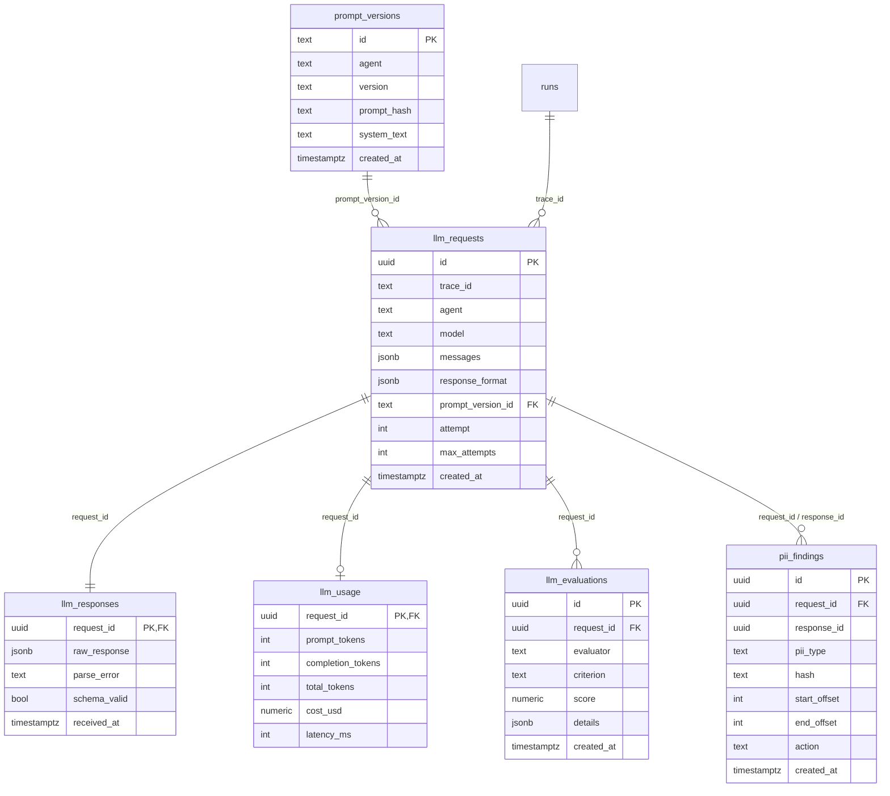

# Модель данных LLM-наблюдаемости (#13)

Документ описывает хранение запросов, ответов, токен-usage, оценок качества и
найденных PII для AI-контура (interviewer / analyst / synthesizer). СУБД —
PostgreSQL. Схема аддитивная: существующие таблицы `llm_cache` и
`skill_embedding_cache` (Phase 2) не меняются.

## Принципы

1. **Трассируемость.** Каждый вызов модели связан с `trace_id` (run/сессия) и
   `prompt_version_id` (конкретная версия промпта, из `prompt_hash`).
   Ответ нельзя воспроизвести без обоих.
2. **Разделение данных.** `llm_requests` хранит то, что отправлено, `llm_responses`
   — что получено. Это позволяет удалять/обезличивать ответы, сохраняя метрики.
3. **Деньги и токены отдельно.** `llm_usage` — агрегат по попытке; запросы
   метрик не сканируют большой текстовый слой.
4. **PII не в открытом виде.** Найденные PII-фрагменты не дублируются в
   `pii_findings`: хранятся тип, позиция и хэш; исходный текст остаётся в
   `llm_responses` до истечения retention и затем вычищается.
5. **Оценки — отдельный поток.** `llm_evaluations` заполняется асессорами и
   автоматическими проверками (evidence quote match, schema valid, conflict
   priority agreement), не блокируя основной путь.

## ER-диаграмма



## DDL

```sql
CREATE TABLE prompt_versions (
    id            text PRIMARY KEY,              -- agent/version/short-hash
    agent         text NOT NULL CHECK (agent IN ('interviewer','analyst','synthesizer')),
    version       text NOT NULL,                  -- v1, v2, ...
    prompt_hash   char(64) NOT NULL,              -- SHA-256 composed prompt
    system_text   text NOT NULL,
    created_at    timestamptz NOT NULL DEFAULT now(),
    UNIQUE (agent, version, prompt_hash)
);

CREATE TABLE llm_requests (
    id                 uuid PRIMARY KEY DEFAULT gen_random_uuid(),
    trace_id           text NOT NULL,             -- run id / interview session id
    agent              text NOT NULL CHECK (agent IN ('interviewer','analyst','synthesizer')),
    model              text NOT NULL,
    messages           jsonb NOT NULL,            -- role/content array; PII masked before insert
    response_format    jsonb,                     -- json_schema wrapper, if any
    prompt_version_id  text NOT NULL REFERENCES prompt_versions(id),
    attempt            int NOT NULL DEFAULT 1,
    max_attempts       int NOT NULL DEFAULT 3,
    created_at         timestamptz NOT NULL DEFAULT now()
);
CREATE INDEX llm_requests_trace_idx ON llm_requests (trace_id);
CREATE INDEX llm_requests_agent_created_idx ON llm_requests (agent, created_at DESC);

CREATE TABLE llm_responses (
    request_id     uuid PRIMARY KEY REFERENCES llm_requests(id) ON DELETE CASCADE,
    raw_response   jsonb,                         -- parsed JSON; null if unparseable
    response_text  text,                          -- raw model text, purged by retention
    parse_error    text,
    schema_valid   boolean NOT NULL DEFAULT false,
    received_at    timestamptz NOT NULL DEFAULT now()
);

CREATE TABLE llm_usage (
    request_id        uuid PRIMARY KEY REFERENCES llm_requests(id) ON DELETE CASCADE,
    prompt_tokens     int NOT NULL DEFAULT 0,
    completion_tokens int NOT NULL DEFAULT 0,
    total_tokens      int NOT NULL DEFAULT 0,
    cost_usd          numeric(12, 6) NOT NULL DEFAULT 0,
    latency_ms        int NOT NULL DEFAULT 0
);

CREATE TABLE llm_evaluations (
    id          uuid PRIMARY KEY DEFAULT gen_random_uuid(),
    request_id  uuid NOT NULL REFERENCES llm_requests(id) ON DELETE CASCADE,
    evaluator   text NOT NULL,                    -- 'human:<id>' | 'auto:quote_match' | ...
    criterion   text NOT NULL,                    -- schema_valid | quote_match | dedup_precision | conflict_priority
    score       numeric(4, 3) NOT NULL CHECK (score BETWEEN 0 AND 1),
    details     jsonb NOT NULL DEFAULT '{}'::jsonb,
    created_at  timestamptz NOT NULL DEFAULT now()
);
CREATE INDEX llm_evaluations_criterion_idx ON llm_evaluations (criterion, created_at DESC);

CREATE TABLE pii_findings (
    id            uuid PRIMARY KEY DEFAULT gen_random_uuid(),
    request_id    uuid NOT NULL REFERENCES llm_requests(id) ON DELETE CASCADE,
    response_id   uuid REFERENCES llm_responses(request_id) ON DELETE CASCADE,
    pii_type      text NOT NULL,                  -- name|phone|email|address|passport|...
    hash          text NOT NULL,                  -- sha256(pii) для дедупликации без раскрытия
    start_offset  int,
    end_offset    int,
    action        text NOT NULL CHECK (action IN ('masked','blocked','allowlisted')),
    created_at    timestamptz NOT NULL DEFAULT now()
);
CREATE INDEX pii_findings_type_idx ON pii_findings (pii_type, created_at DESC);
```

`gen_random_uuid()` доступен через `pgcrypto` в PostgreSQL 13+.

## Политика хранения и PII

| Данные | Retention | Что делаем |
|---|---|---|
| `llm_requests.messages` | 90 дней | PII маскируется на входе в БД (`pii_findings.action='masked'`), хранится маскированная версия |
| `llm_responses.response_text` | 30 дней | после — `UPDATE ... SET response_text = NULL`; JSON `raw_response` остаётся для метрик |
| `llm_usage` | 400 дней | агрегаты без текста, храним долго для отчётности |
| `llm_evaluations` | 400 дней | текстовых PII нет; `details` проходит тот же маскировщик |
| `pii_findings` | 400 дней | хранится только тип, хэш и позиция, исходное значение никогда |
| `prompt_versions` | бессрочно | промпт — часть артефакта качества |

Правила:

1. **Маскирование до записи.** `messages` и `raw_response` проходят
   `internal/guardrails`-совместимый PII-фильтр в момент записи; в
   `pii_findings` фиксируется найденное.
2. **Запрет на PII в логах/метриках.** `trace_id` — случайный UUID, не
   содержит ФИО/телефонов; `text` в `agent_messages` маскируется по тем же
   правилам.
3. **Удаление по требованию.** `DELETE /runs/{trace_id}` удаляет
   `llm_requests` каскадом (`responses`, `usage`, `evaluations`, `pii_findings`).
4. **Обезличивание.** Для долгосрочных исследований экспортируется
   `llm_usage` + `llm_evaluations` (без текстов), этого достаточно для метрик
   качества.

## Примеры запросов

Токены и стоимость по агенту за неделю:

```sql
SELECT r.agent,
       count(*)                          AS requests,
       sum(u.prompt_tokens)              AS prompt_tokens,
       sum(u.completion_tokens)          AS completion_tokens,
       sum(u.cost_usd)                   AS cost_usd,
       round(avg(u.latency_ms))          AS avg_latency_ms
FROM llm_requests r
JOIN llm_usage u ON u.request_id = r.id
WHERE r.created_at >= now() - interval '7 days'
GROUP BY r.agent
ORDER BY cost_usd DESC;
```

Доля ответов, не прошедших схему, и успешность ремонта:

```sql
SELECT r.agent,
       count(*)                                           AS attempts,
       count(*) FILTER (WHERE NOT res.schema_valid)       AS invalid,
       round(100.0 * count(*) FILTER (WHERE NOT res.schema_valid) / count(*), 2) AS invalid_pct,
       count(*) FILTER (WHERE r.attempt > 1)              AS repaired_attempts
FROM llm_requests r
JOIN llm_responses res ON res.request_id = r.id
WHERE r.created_at >= now() - interval '30 days'
GROUP BY r.agent;
```

Качество по критериям (например, дословность цитат):

```sql
SELECT e.criterion,
       count(*)                         AS evaluations,
       round(avg(e.score), 3)           AS avg_score,
       count(*) FILTER (WHERE e.score < 1) AS failures
FROM llm_evaluations e
WHERE e.created_at >= now() - interval '30 days'
GROUP BY e.criterion
ORDER BY avg_score ASC;
```

Найти все запросы run и его стоимость (трассировка по `trace_id`):

```sql
SELECT r.id, r.agent, r.model, r.attempt, r.created_at,
       res.schema_valid, u.total_tokens, u.cost_usd
FROM llm_requests r
LEFT JOIN llm_responses res ON res.request_id = r.id
LEFT JOIN llm_usage u       ON u.request_id = r.id
WHERE r.trace_id = $1
ORDER BY r.created_at, r.attempt;
```

PII, найденные за последние сутки:

```sql
SELECT p.pii_type, p.action, count(*) AS findings
FROM pii_findings p
WHERE p.created_at >= now() - interval '1 day'
GROUP BY p.pii_type, p.action
ORDER BY findings DESC;
```

## Связь с кодом

- `internal/llm` (`ChatClient`, `CircuitBreaker`) — источник `model`,
  `latency_ms`, `attempt`;
- `internal/prompts` — источник `prompt_version_id` и `prompt_hash`;
- `internal/agent/contract.go` — `trace_id`, `prompt_version` в `Envelope`;
- `internal/guardrails` (если включён) — источник `pii_findings`.
